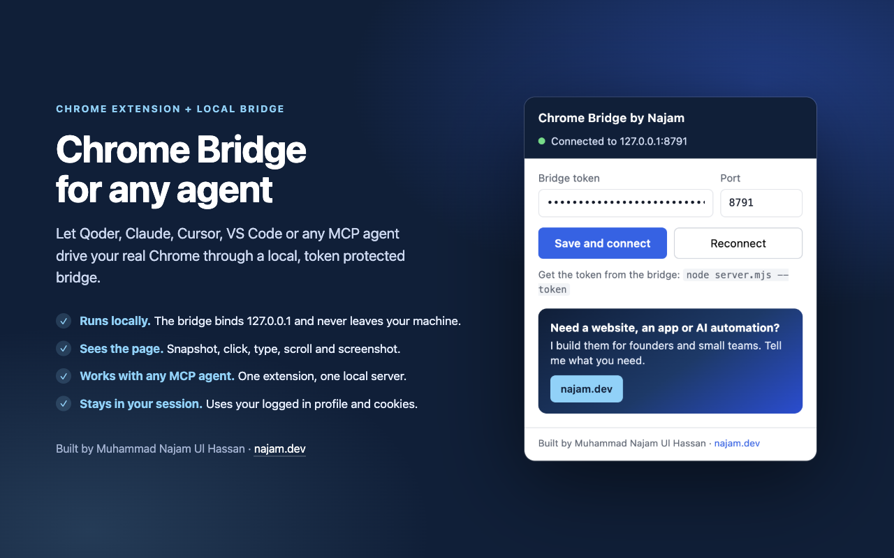

# Chrome Bridge

Drive your **real Chrome profile** from Qoder, Claude, Cursor, VS Code, Windsurf, Cline, Gemini CLI, Codex or any MCP client: your logins, your extensions, your windows, in the Chrome you already use. A tiny local server connects your agent to a Chrome extension, so it can open tabs, read a page, click, type, scroll and take screenshots, the same way you would.

Built by **Muhammad Najam Ul Hassan**.

> **Need a website, an app or AI automation?** I build them for founders and small teams.
> Tell me what you need at **[najam.dev](https://najam.dev)**.



Unofficial community tool. Not affiliated with or endorsed by Qoder, OpenAI, Anthropic, Google or any editor vendor.

## Why

Most browser automation launches a separate, clean Chrome profile. That profile has none of your logins, so sites that need a real session (Cloudflare, Vercel, GitHub, a client dashboard) ask you to sign in again and often block automation.

Chrome Bridge runs inside the Chrome you already use. You keep your session; the agent gets a way in.

```
MCP client (stdio)  ->  mcp/server.mjs  ->  http://127.0.0.1:8791  ->  Chrome extension  ->  your tab
Shell or Qoder      ->  cli.mjs         ->  http://127.0.0.1:8791  ->  Chrome extension  ->  your tab
```

- `server.mjs`: a localhost-only HTTP bridge with a command queue and long polling. Binds `127.0.0.1`, and every request needs the pairing token.
- `mcp/server.mjs`: a stdio MCP server that exposes the bridge as 16 tools. Any MCP client can use it.
- `cli.mjs`: the command line for shells and agents that do not speak MCP.
- `extension/`: a Manifest V3 extension. It polls the bridge, runs the command and posts the result back.
- `token`: the shared secret, created on first run (`chmod 600`) and kept out of git and the packaged extension.

## Requirements

- Google Chrome 116 or newer (any platform)
- Node.js 20 or newer
- An MCP client, or a shell

## Install

1. **Clone, install and start the bridge**

   ```bash
   git clone https://github.com/itsnajam/qoder-chrome-bridge.git ~/.chrome-bridge
   cd ~/.chrome-bridge
   npm install
   node server.mjs
   ```

   On first run the server creates `token` and prints where it is. Keep the server running while you want an agent to drive Chrome.

2. **Load the extension**

   - Open `chrome://extensions`
   - Turn on **Developer mode**
   - Click **Load unpacked** and pick `~/.chrome-bridge/extension`
   - Pin **Chrome Bridge by Najam** to the toolbar

3. **Pair it**

   ```bash
   node ~/.chrome-bridge/server.mjs --token
   ```

   Copy that token, open the extension popup, paste it, and click **Save and connect**. The badge turns to `on` when it is connected.

4. **Check the connection**

   ```bash
   node ~/.chrome-bridge/cli.mjs ping
   node ~/.chrome-bridge/cli.mjs tabs
   ```

   `ping` should return `"pong": true` and the number of open tabs.

## Use from your agent

Every MCP client that supports a local stdio server can use the same command. Point it at `mcp/server.mjs` in your clone:

```json
{
  "mcpServers": {
    "chrome-bridge": {
      "command": "node",
      "args": ["/Users/you/.chrome-bridge/mcp/server.mjs"]
    }
  }
}
```

Replace `/Users/you` with your home path. On Windows use `C:\\Users\\you\\.chrome-bridge\\mcp\\server.mjs` with doubled backslashes. If a desktop app cannot find `node`, replace the command with the absolute path from `which node`.

| Client | Where the config goes |
| --- | --- |
| Qoder | Settings, MCP servers, add a stdio server, or install the skill below |
| Claude Desktop | `~/Library/Application Support/Claude/claude_desktop_config.json` (macOS) |
| Claude Code | `claude mcp add --scope user chrome-bridge -- node ~/.chrome-bridge/mcp/server.mjs` |
| Cursor | `~/.cursor/mcp.json` or `.cursor/mcp.json` |
| VS Code | `.vscode/mcp.json`, with `"servers"` instead of `"mcpServers"` |
| Windsurf | `~/.codeium/windsurf/mcp_config.json` |
| Cline | MCP Servers, Installed, Configure, then edit `cline_mcp_settings.json` |
| Gemini CLI | `~/.gemini/settings.json` |
| Codex CLI and IDE extension | `~/.codex/config.toml`, or Settings, MCP servers, Add server |

Detailed snippets for each client are in [docs/agents.md](docs/agents.md).

**ChatGPT desktop and web:** OpenAI's connector UI only accepts public HTTPS URLs. It cannot reach a server on your machine, and pointing a tunnel at this bridge would expose your Chrome session to the internet. Do not do that. Use Codex CLI or the Codex IDE extension instead, which runs the same MCP server locally and uses the same OpenAI account.

## Use it from Qoder

The repo ships a Qoder skill that tells the agent when to use Chrome and how to install it. Install it once:

```bash
npx skills add itsnajam/qoder-chrome-bridge --skill chrome-bridge -a qoder
```

Then ask Qoder something like "Can you open this site in my Chrome and fill the form?" Qoder will check the bridge, help you load the extension, and run the commands.

## MCP tools

| Tool | What it does |
| --- | --- |
| `chrome_health` | Bridge and extension connection state |
| `chrome_ping` | Round-trip check, extension id and tab count |
| `chrome_tabs` | List open tabs with ids, windows, titles and URLs |
| `chrome_open` | Open a URL in a new tab, in the background by default |
| `chrome_goto` | Navigate an existing tab |
| `chrome_activate` | Bring a tab and its window to the front, only when the user needs to see it |
| `chrome_close` | Close a tab |
| `chrome_snapshot` | Page text plus numbered interactive elements |
| `chrome_click` | Real mouse click on a snapshot ref or CSS selector |
| `chrome_mouse` | Trusted move, down, up or click at coordinates or an element |
| `chrome_type` | Set a field value, optional form submit |
| `chrome_press` | Real key event with the code the page expects |
| `chrome_scroll` | Scroll the page or an element into view |
| `chrome_wait` | Wait a duration or for a selector |
| `chrome_screenshot` | PNG of a tab, including background tabs, without moving focus |
| `chrome_eval` | Run JavaScript in the page's main world |

`chrome_snapshot` numbers the elements it can see and writes `data-qcb-ref` on them. Refs stay valid until the next snapshot or navigation. Take a fresh snapshot after clicks that change the page.

`chrome_click`, `chrome_press` and `chrome_mouse` attach the Chrome debugger to the target tab, send the event through `Input.dispatchMouseEvent` or `Input.dispatchKeyEvent`, and detach again. That means menus and widgets built on `mousedown` or `pointerdown` open, and shortcuts read the real `keyCode`: Gmail's `#` delete and Slack's per-message kebab both work. While attached, Chrome shows its "being debugged" banner. If the debugger cannot attach, because DevTools is already open on that tab, the command falls back to a synthetic event and reports `mode:"synthetic"` with a warning.

The same trusted events also reach a tab that is not on screen. Chrome drops key and press input for background tabs, so the extension turns on focus emulation for the moment of the command. Nothing moves on screen. One side effect: that tab keeps reporting `document.hasFocus() === true` until it navigates again.

## CLI

```bash
node cli.mjs health                            # bridge and connection state
node cli.mjs ping
node cli.mjs tabs
node cli.mjs open <url> [tabId]                # new tab
node cli.mjs goto <url> [tabId]
node cli.mjs activate <tabId>
node cli.mjs close <tabId>
node cli.mjs snapshot [tabId] [max]            # numbered, visible elements plus page text
node cli.mjs click <ref|selector> [tabId]      # trusted click on the element centre
node cli.mjs mouse <click|move|down|up> <ref|selector> [tabId]
node cli.mjs mouse <click|move|down|up> <x> <y> [tabId]
node cli.mjs hover <ref|selector> [tabId]      # move the pointer without clicking
node cli.mjs type <ref|selector> <text> [tabId] [--submit]
node cli.mjs press <key> [ref] [tabId]
node cli.mjs scroll <y> [tabId]
node cli.mjs wait <ms>
node cli.mjs wait --selector "<css>" [tabId] [timeoutMs]
node cli.mjs screenshot [tabId]                # saved under shots/
node cli.mjs eval '<javascript>' [tabId]       # runs in the page's main world
node cli.mjs '{"cmd":"snapshot","tabId":123}'  # raw command
```

- `type` sets the field value and fires `input` and `change`, so React and Vue forms see it. Add `--submit` to submit the surrounding form.
- `press` takes `Enter`, `Escape`, `Tab`, `Backspace`, `Delete`, `Space`, `ArrowUp`, `Home`, `PageDown`, `F5`, a single letter or digit, or a symbol such as `#`. Uppercase letters and shifted symbols carry the shift modifier.
- `click` and `press` run on the focused element when you give no ref. To aim at a background tab without a ref, add `--tab <id>` to any page command.
- Two numbers after `mouse` are viewport pixels. If you mean a snapshot ref plus a tab id, write `node cli.mjs mouse click 44 --tab 211439585`.
- `screenshot` captures the visible viewport as a PNG. A background tab is captured through the debugger, so the browser never comes forward. The result reports `mode:"visible"`, `"background"` or `"focused"`; only `"focused"` means the user's screen moved, and that happens only when the window is minimized or the debugger cannot attach.

Set `QCB_PORT` (default `8791`) and `QCB_TOKEN` (default: the `token` file) if your setup differs. The MCP server reads the same variables.

## Security model

This tool can do anything you can do in Chrome. Treat it accordingly.

- The bridge listens on `127.0.0.1` only. Nothing on your network can reach it.
- Every request carries the token. The server rejects requests without it, and cross-origin requests from web pages are refused.
- The token is created locally and never leaves your machine. It is not in the extension package.
- The extension has host access to all sites because it must work on whichever page you are on. It only acts when a command arrives from your local bridge.
- The `debugger` permission is used only to send real mouse and key events to the tab a command names, and it detaches as soon as that command finishes. It is not used to read the page or to inspect your network.
- Only run the server while you need it. To revoke access, stop the server, remove the extension, or rotate the token.

Do not expose port `8791` through a tunnel, reverse proxy or firewall rule. A public tunnel would let anyone who finds the URL drive your browser.

## Troubleshooting

- **Badge shows `set`:** the extension has no token. Open the popup and paste the one from `node server.mjs --token`.
- **Badge shows `!`:** the bridge is not reachable or the token is wrong. Check that `node server.mjs` is running, then click **Reconnect**.
- **`extension not connected`:** Chrome has suspended the service worker, or the extension needs reloading after an update. Click **Reconnect** in the popup, or reload the extension in `chrome://extensions`.
- **`element not found`:** take a fresh snapshot. Refs expire on navigation.
- **`chrome://` pages:** Chrome blocks extensions from scripting its own pages. Use a normal page.
- **Screenshot fails with `activeTab`:** the bridge must capture an HTTP or HTTPS page. `chrome://` pages cannot be captured.
- **A click or key reports `mode:"synthetic"`:** DevTools is open on that tab, so the debugger could not attach. Close DevTools and repeat the command.
- **"Chrome is being debugged by software on your machine" banner:** that is a trusted mouse or key command. It disappears when the command finishes.

## Limitations

- No `chrome://` pages, cross-origin iframes, or shadow DOM inside shadow DOM.
- Screenshots capture the visible viewport, not the full page.
- File uploads and native dialogs are not supported yet.
- Drag and drop needs a continuous pointer, so it is not supported. Each trusted mouse event is a separate command.
- Trusted clicks and keys need the debugger, so they fall back to synthetic events while DevTools is open on the same tab.
- Commands run one at a time, up to 40 seconds each.
- The extension does not load or run remote code.
- ChatGPT desktop and web cannot connect to a local-only server. Use Codex CLI or the Codex IDE extension.

## Privacy

See [PRIVACY.md](PRIVACY.md). No analytics, no telemetry, no remote server. Page data goes only to the bridge on your own computer.

## License

[MIT](LICENSE). Copyright (c) 2026 Muhammad Najam Ul Hassan.

## Credit

Built by [Muhammad Najam Ul Hassan](https://najam.dev). If this saves you time, the best thank-you is to send interesting work my way: [najam.dev](https://najam.dev).
